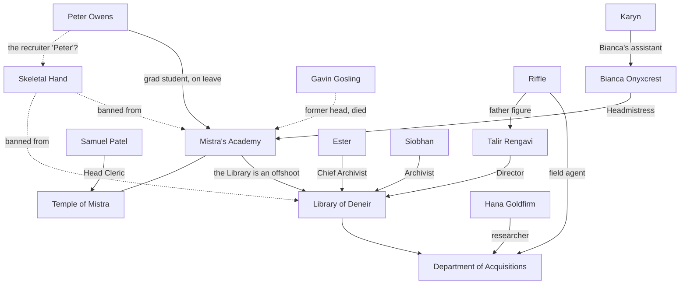
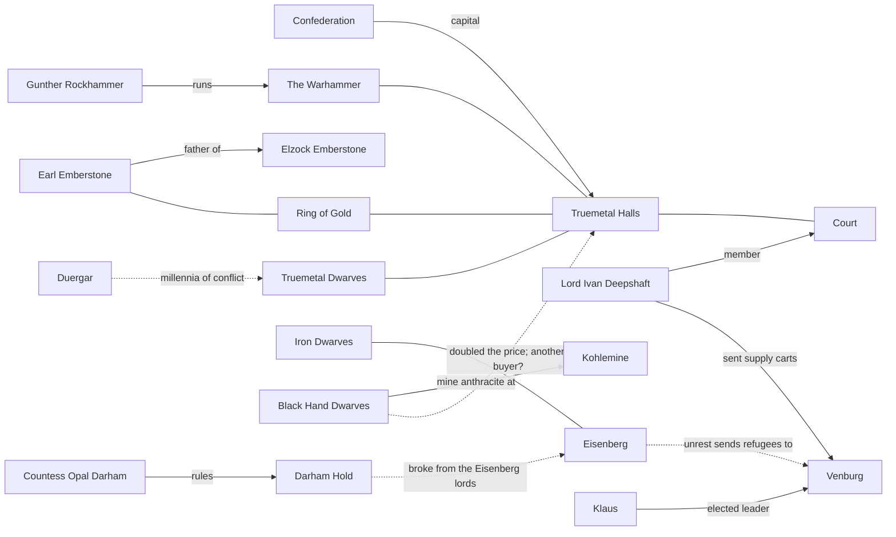
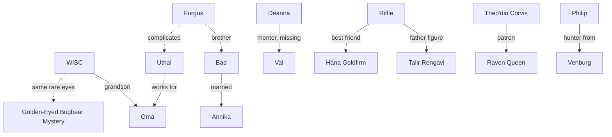
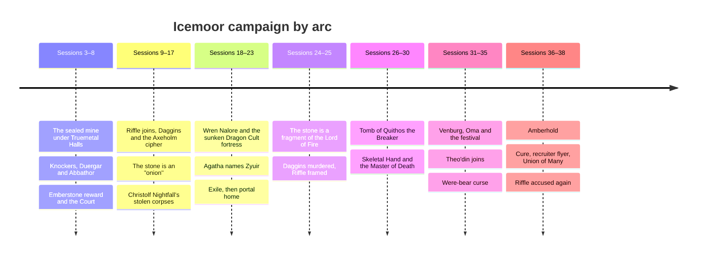

# Relationships

Diagrams of who belongs to what and how the campaign's arcs connect. They render natively in Obsidian; click a box to open its note. Dotted lines are suspicions or unconfirmed links, not established facts.

For thread-by-thread boards, see the canvases linked from the [[Campaign Dashboard]].

## Amberhold institutions

## Dwarven powers and Venburg

## The party's people

## Campaign arcs

